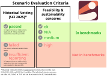

---
hide:
  - navigation
  - toc
---

<div style="display: flex; flex-wrap: wrap; justify-content: center; align-items: center; gap: 20px; margin-bottom: 30px;">
  <div style="flex: 1 1 auto; min-width: 250px; max-width: 600px;">
    
    
  </div>
  <div style="flex: 0 1 auto; text-align: center;">
    <p>Developed as part of the <a href="https://scenariocompass.org/">Scenario Compass Initiative</a>.</p>
    
    
  </div>
</div>

<h1 style="position: absolute; width: 1px; height: 1px; padding: 0; margin: -1px; overflow: hidden; clip: rect(0, 0, 0, 0); white-space: nowrap; border: 0;">Scenario Evaluation Criteria</h1>

<div style="text-align: center;" markdown>
[](https://github.com/IAMconsortium/scenario-evaluation-criteria/blob/main/LICENSE.md)
[](https://scenario-evaluation-criteria.iamconsortium.org/)
[](https://github.com/IAMconsortium/scenario-evaluation-criteria/actions/workflows/ci.yml)
[](https://doi.org/10.5281/zenodo.21771914)
</div>

<p style="text-align: center; font-size: 1.2em;"><em>A set of community criteria for evaluating integrated assessment emissions scenarios.</em></p>

Integrated Assessment Models (IAMs) are computational models that produce scenarios of economy, energy system, land use, and greenhouse-gas emissions developments over time, across regions, and under different policy assumptions. Those scenarios are often evaluated in the process of producing new scenarios or when collecting and assessing existing scenarios. Specifically, IAM scenarios are often checked against empirical observations, near-term projections, and sustainability targets to identify scenarios that are outdated, internally inconsistent, technically infeasible, or ecologically or socially undesirable.

This website documents the criteria used to evaluate scenarios in the [Scenario Compass Initiative (SCI)](https://scenariocompass.org/). The criteria are developed to curate a high-quality scenario ensemble suitable for a wide range of scenario users. Following a transparent, community-driven process, the scenario evaluation criteria are reviewed every year and published in a versioned, machine-readable format. In addition, this website details the chosen thresholds, reference data, and justification for each criterion.

---

## How the criteria are developed

The criteria are developed by the SCI in collaboration with the IAMC Scientific Working Groups on Scenarios and on Data, following the subsequent steps:

1. __Proposal.__ SCI working groups derive criteria and thresholds from peer-reviewed literature and official data sources.
2. __Open review.__ Draft criteria are published on this site for public review. The call is advertised online, through community mailing lists, and through professional networks.
3. __Response and revision.__ Responses to reviewer comments are made public. In the first public review, reviewers received direct responses to their comments and the resulting changes to the criteria via email.
4. __Release.__ The revised criteria are released as a new version and applied in the annual update of the Scenario Compass ensemble.

In general, criteria are required to refer to variables that are critical for the global energy transition, reported consistently across scenarios in the database, and that can be linked to quantifiable thresholds derived from scientific literature or official data sources.

---

## Versions

The documentation is published separately for each version of the criteria.

| Version | Public review | Source | Zenodo |
|---------|---------------|--------|--------|
| [latest](latest/) | — | Branch [`main`](https://github.com/IAMconsortium/scenario-evaluation-criteria/tree/main) | — |
| [2026.08.03](2026.08.03/) (stable) | January 17 – February 10, 2025 | Release [`v2026.08.03`](https://github.com/IAMconsortium/scenario-evaluation-criteria/releases/tag/v2026.08.03) | [10.5281/zenodo.21771915](https://doi.org/10.5281/zenodo.21771915) |
| [2026-update](2026-update/) | August 21 – September 21, 2026 (ongoing) | Branch [`2026-update`](https://github.com/IAMconsortium/scenario-evaluation-criteria/tree/2026-update) | — |

<div class="grid cards" markdown>

-   :octicons-info-24:{ .lg .middle } __Summary__

    ---

    Look at the summary page of the criteria definitions.

    [:octicons-arrow-right-24: See summary](stable/)

-   :octicons-three-bars-24:{ .lg .middle } __Components__

    ---

    Look at the individual components defining the criteria.

    [:octicons-arrow-right-24: See components](stable/components/)

-   :octicons-code-24:{ .lg .middle } __Tutorials__

    ---

    Look at R and Python tutorials for loading and applying the criteria.

    [:octicons-arrow-right-24: See tutorials](stable/tutorials/)

</div>

---

## Two types of criteria

There are two types of evaluation criteria: historical vetting as well as feasibility and sustainability concerns.

- __Historical vetting.__ Scenarios are evaluated for correctly representing the current energy system. They are marked as inconsistent if they do not match reported historical real-world estimates for time periods in the past.
- __Feasibility and sustainability concerns.__ The feasibility evaluation concentrates on whether the near-term pace of technology deployment assumed in scenarios stays within empirically grounded bounds. An upper bound checks whether deployment is faster than existing capacity, project pipelines, lead times, and market dynamics can support. A lower bound, near-term plausibility, checks whether deployment falls implausibly low given capacity already operating or committed. The sustainability evaluation focuses on whether scenarios stay within resource and environmental limits, such as levels of bioenergy use, food availability, and cumulative geological CO₂ storage.

<figure markdown>
  { style="width: 100%; max-width: 900px;" }
  <figcaption>SCI's scenario evaluation criteria and their implications for the community benchmarks reported in "Mitigation benchmarks from the 2025 community update of global emissions pathways" (Riahi et al., submitted).</figcaption>
</figure>

The criteria are applied on the SCI scenario database to derive a high-quality scenario ensemble recommended to use, amongst others for community benchmarks (see Riahi et al., submitted for the first edition of the community benchmarks). Please note that no scenario is removed from the database: all scenarios are recorded and remain available to users. Evaluation criteria are only used to identify a recommended scenario ensemble for benchmarking and other uses of scenario information.

Failing or insufficiently reporting variables required for historical vetting leads to a scenario not being represented in the benchmarking scenario ensemble. When a feasibility or sustainability threshold is crossed, the scenario is flagged with a medium or high concern. A medium concern marks the point where problems may begin to emerge. Medium concerns do not affect whether a scenario is included in the scenario ensemble. A high concern means a value is either inconsistent even with the most optimistic reading of current evidence, or that a scenario raises serious sustainability concerns, leading to the scenario not being considered for the benchmark-relevant ensemble.

---

## Citation

Please cite as:

```python exec="true" session="index" showcode="false"
from pathlib import Path

import yaml

cff = yaml.safe_load(Path("CITATION.cff").read_text())


def _format_author(author):
    given = author.get("given-names", "").split()
    initials = " ".join(f"{part[0]}." for part in given if part)
    family = author.get("family-names", "")
    return f"{family}, {initials}".strip().rstrip(",")


authors = [_format_author(a) for a in cff["authors"]]
if len(authors) > 1:
    author_str = ", ".join(authors[:-1]) + ", & " + authors[-1]
else:
    author_str = authors[0]

year = str(cff["date-released"]).split("-")[0]
title = cff["title"]
version = cff["version"]
# Overridden on this branch: no DOI is minted for unreleased work, so link
# to the branch itself instead (restore the CITATION.cff-derived DOI link
# once this lands on main and gets a release).
url = "https://github.com/IAMconsortium/scenario-evaluation-criteria/tree/2026-update"

print(
    f"> {author_str} ({year}). *{title}* "
    f"(Version {version}) [Computer software]. {url}"
)
```

---

## License

All data and code are published under the [MIT licence](https://github.com/IAMconsortium/scenario-evaluation-criteria/blob/main/LICENSE.md).

---

{{ readme_section('## Acknowledgments') }}

<p align="center">
  
  
  
  
</p>
